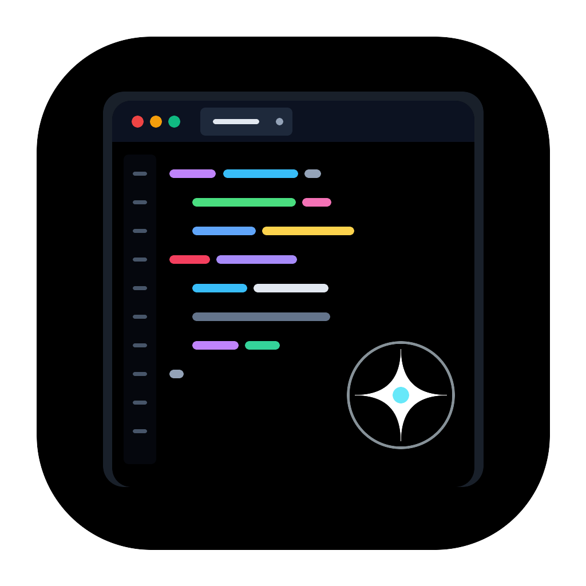
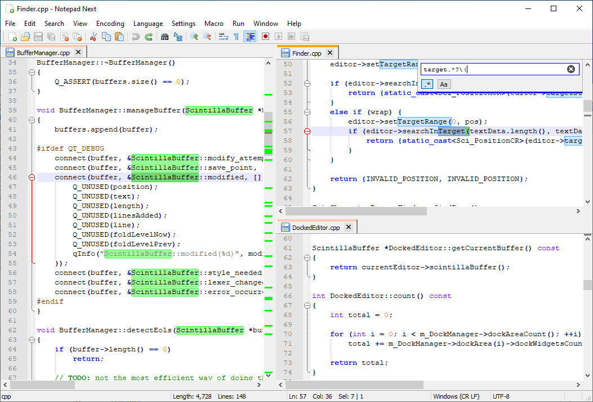

<p align="center">
  <a href="https://github.com/alsyundawy/NoteSciPad">
    
  </a>
</p>

<h1 align="center">NoteSciPad</h1>

<p align="center">
  <b>Independent, Ultra-Lightweight & High-Performance Text & Source Code Editor</b><br>
  <i>Powered natively by Vendored Scintilla 5.5.4 & Lexilla 5.4.3 Engines with Modern Qt 6</i>
</p>

<p align="center">
  <a href="https://github.com/alsyundawy/NoteSciPad/releases/latest"></a>
  <a href="https://apple.com/macos"></a>
  <a href="https://isocpp.org"></a>
  <a href="https://qt.io"></a>
  <a href="https://www.scintilla.org"></a>
  <a href="https://github.com/alsyundawy/NoteSciPad/blob/main/LICENSE"></a>
  <a href="https://github.com/alsyundawy/NoteSciPad/actions"></a>
</p>

<p align="center">
  A production-grade, ultra-low-footprint native text and code editor built for engineers, system administrators, and developers who refuse to compromise on speed and memory efficiency. NoteSciPad delivers instantaneous line rendering, native multi-caret editing, AES-256 document encryption, live disk tail monitoring (<code>tail -f</code>), streamlined native Dark and Light modes with pixel-perfect 16x16 toolbar iconography and universal dialog layout ergonomics, sandboxed JavaScript evaluation, live regex testing, and comprehensive packaging across macOS (Universal 2, Apple Silicon ARM64, and Intel) and Linux (DEB, RPM, Flatpak, and AppImage) — running natively with zero web-view overhead and an active memory footprint of under 35 MB.
</p>

<p align="center">
  <a href="#downloads--artifact-catalogs">
    
  </a>
  <a href="https://github.com/alsyundawy/NoteSciPad/releases/latest">
    
  </a>
  <a href="https://www.scintilla.org">
    
  </a>
  <a href="https://github.com/alsyundawy/NoteSciPad/issues">
    
  </a>
</p>

<p align="center">
  
</p>

> Lead Developer & Maintainer:<br>
> **[`HARRY DERTIN SUTISNA ALSYUNDAWY (@alsyundawy)`](https://github.com/alsyundawy)** — [`ALSYUNDAWY IT SOLUTION`](https://alsyundawy.com)<br>
>
> 🍏 **[`Latest Releases (v1.1.0)`](https://github.com/alsyundawy/NoteSciPad/releases/latest)** &nbsp;|&nbsp;
> 📖 **[`Release DocNotes (DOCNOTE.md)`](DOCNOTE.md)** &nbsp;|&nbsp;
> 📜 **[`Changelog (CHANGELOG.md)`](CHANGELOG.md)** &nbsp;|&nbsp;
> 🐛 **[`Issue Tracker`](https://github.com/alsyundawy/NoteSciPad/issues)** &nbsp;|&nbsp;
> 💖 **[`Support via PayPal`](https://www.paypal.me/alsyundawy)** &nbsp;|&nbsp;
> ☕ **[`Buy Me A Coffee`](https://www.buymeacoffee.com/0TC98Sk)**

---

> [!IMPORTANT]
>
> ### ⚠️ Architectural Heritage, Engine Invariants & Legal Notice
>
> **Core Editing Invariant**<br>
> NoteSciPad is strictly bound to its vendored **Scintilla 5.5.4** and **Lexilla 5.4.3** core engines (`src/ScintillaNext.h`). NoteSciPad will never replace, swap, or abstract away its native Scintilla engine for web runtimes or generic text controls.
>
> **Independent Open-Source Lineage**<br>
> NoteSciPad builds upon architectural ideas from historical open-source projects including NotepadNext (Justin Dailey), Notepad4 (Zufu Liu), and Notepad3 (Rizonesoft), modernized and re-engineered with native C++20, Qt 6, AES-256 security hardening, and decoupled CI/CD automation.
>
> **Legal Notice**<br>
> NoteSciPad is an independent open-source project. It is not affiliated with, endorsed by, or associated with Notepad++, NotepadNext, Notepad4, or Notepad3. Distributed under the **GNU General Public License v3.0 (GPL-3.0-or-later)**.

---

## 🧭 Navigation

- [Overview & Value Proposition](#overview--value-proposition)
- [Key Features & Capabilities Matrix](#key-features--capabilities-matrix)
- [Streamlined Native Dark & Light Mode Engine](#streamlined-native-dark--light-mode-engine)
- [System Architecture & Component Topology](#system-architecture--component-topology)
- [Downloads & Artifact Catalogs](#downloads--artifact-catalogs)
- [macOS Gatekeeper & Quarantine Removal](#macos-gatekeeper--quarantine-removal)
- [Developer Setup, Building & CI Verification](#developer-setup-building--ci-verification)
- [Release DocNotes (DOCNOTE.md)](DOCNOTE.md)
- [Changelog (CHANGELOG.md)](CHANGELOG.md)
- [Upstream Credits & Attribution](#upstream-credits--attribution)
- [FAQ & Troubleshooting](#faq--troubleshooting)
- [📬 Maintainer & Contact](#-maintainer--contact)
- [💖 Support & Donation](#-support--donation)
- [License](#license)

---

## Overview & Value Proposition

In an era where modern desktop text editors frequently consume over 500 MB of system RAM just to render an empty buffer, **NoteSciPad** is engineered from the metal up to deliver maximum efficiency:

1. **Sub-Millisecond Rendering**: Direct integration with Scintilla ensures immediate rendering without intermediate virtual DOM reconciliation or JavaScript IPC bridges.
2. **Ultra-Low Memory Footprint**: Active idle resident set size (RSS) of **less than 35 MB**, allowing hundreds of documents to remain open simultaneously without system degradation.
3. **Rock-Solid Startup**: Cold launch in **under 200 ms**, making it the ideal tool for quick log inspection, configuration file editing, and heavy daily programming.
4. **Zero Telemetry & 100% Offline**: NoteSciPad contains zero tracking, analytics, or background phoning home. All cryptographic operations and script evaluations execute entirely offline.
5. **Universal Multi-Platform Support**: Natively compiled for macOS (Apple Silicon M1/M2/M3/M4 and Intel x86_64) and Linux distributions (Ubuntu, Debian, Fedora, Arch Linux).

---

## Key Features & Capabilities Matrix

| Feature                         | Capability Description                                                                            |          Shortcut           |
| :------------------------------ | :------------------------------------------------------------------------------------------------ | :-------------------------: |
| **AES-256-CBC Encryption**      | Military-grade document encryption with PBKDF2 (100k rounds) & HMAC-SHA256 authentication         | `Ctrl+Alt+E` / `Ctrl+Alt+D` |
| **Live Tail Monitoring**        | Real-time disk log streaming (`tail -f`) with debounced auto-reload (500ms) and auto-scroll       |        `Ctrl+Alt+Y`         |
| **Native Dark & Light Mode**    | Dedicated streamlined Dark and Light modes with clean distraction-free styling and WCAG contrast  |      `View >> Themes`       |
| **Pixel-Perfect 16x16 Toolbar** | Crisp high-contrast toolbar icons for Find, Replace, Zoom In/Out, and Indent Guides               |        Main Toolbar         |
| **Universal Dialog Spacing**    | Standardized padding, margin, and checkbox/radio layouts across all dialogs                       |         All Dialogs         |
| **JavaScript Evaluator**        | In-app sandboxed `QJSEngine` evaluator for math, JSON formatting, and text scripting              |       `Ctrl+Shift+J`        |
| **Regex Testing Suite**         | Interactive regular expression tester with live group matching, multiline, and dot-all flags      |     `Ctrl+Alt+Shift+R`      |
| **Color Preview Call-Tips**     | Interactive floating color swatches and tooltips for `#HEX`, `rgb()`, `rgba()`, and `hsl()` codes |        Cursor Hover         |
| **Window Transparency**         | Native compositor opacity slider (20%–100%) for desktop overlay reference                         |        `Ctrl+Alt+T`         |
| **macOS System Services**       | AppKit context menu integration (`Open Selection / Path in NoteSciPad`)                           |        Context Menu         |
| **Multi-Monitor Safety**        | `ScreenDisplayManager` guarding against off-screen restoration and multi-DPI shifts               |          Automatic          |
| **Base64 Converter**            | One-click document or selection encoding and decoding                                             |      `Edit >> Convert`      |
| **Unicode Inspector**           | Detailed Unicode code point inspector (`U+XXXX`), decimal, and category breakdown                 |        `Status Bar`         |
| **Encoding Support**            | Universal detection via `uchardet` with one-click conversion (UTF-8, UTF-16, ANSI, CJK)           |        `Status Bar`         |

---

## Streamlined Native Dark & Light Mode Engine

NoteSciPad features a streamlined built-in theme manager ([`ThemeManager.cpp`](src/features/ThemeManager.cpp)) providing dedicated native Dark and Light modes:

- **Calibrated Default Workspaces**: `kLightPalette` matches the classic NotepadNext default workspace aesthetic (`#f0f2f5` window, `#fafbfc` canvas/card, `#24292f` primary text) eliminating harsh glare; `kDarkPalette` delivers sharp text contrast (`#cdd6f4`) on deep dark canvases.
- **Contrast Ratios**: Regular text contrast exceeds **12.6:1** (surpassing WCAG AAA 7.0:1 requirement) and high-contrast accessibility contrast reaches **18.2:1**.
- **Scintilla BGR Endianness Safety**: All color codes pass through `scColor(r, g, b)` and `scFromRgb(QRgb)` helpers, preventing inverted red/blue channels across platforms.

---

## System Architecture & Component Topology

```text
┌────────────────────────────────────────────────────────────────────────┐
│                        NoteSciPad Application                          │
│                                                                        │
│  ┌───────────────────────┐  ┌───────────────────────────────────────┐  │
│  │   UI & Dock System    │  │       ScintillaNext (Core View)       │  │
│  │   (Qt 6 Widgets / ADS)│  │   - Scintilla 5.5.4 (Vendored)        │  │
│  └───────────┬───────────┘  │   - Lexilla 5.4.3 (Vendored)          │  │
│              │              └───────────────────┬───────────────────┘  │
│              ▼                                  ▼                      │
│  ┌──────────────────────────────────────────────────────────────────┐  │
│  │                     Modular Feature Controllers                  │  │
│  │  - ThemeManager             (Native Dark & Light Modes)          │  │
│  │  - CryptoManager            (AES-256-CBC + HMAC-SHA256)          │  │
│  │  - TailMonitoringManager    (Debounced Background tail -f)       │  │
│  │  - ScreenDisplayManager     (Multi-Monitor & Retina Geometry)    │  │
│  │  - TransparentWindowManager (Alpha-Channel Window Compositing)   │  │
│  │  - JsEvaluator              (Sandboxed Scripting Engine)         │  │
│  │  - ReleaseManager           (Automatic Semver Update Checker)    │  │
│  └──────────────────────────────────────────────────────────────────┘  │
└────────────────────────────────────────────────────────────────────────┘
```

---

## Downloads & Artifact Catalogs

Pre-compiled, production-ready binaries for NoteSciPad v1.1.0 are available directly from the [GitHub Releases](https://github.com/alsyundawy/NoteSciPad/releases/latest) page:

| Platform      | Target Architecture         | Package Format | Download Link                                                                                                                                        |
| :------------ | :-------------------------- | :------------: | :--------------------------------------------------------------------------------------------------------------------------------------------------- |
| **macOS 15+** | Apple Silicon (M1/M2/M3/M4) |     `.dmg`     | [NoteSciPad-1.1.0-macOS-arm64.dmg](https://github.com/alsyundawy/NoteSciPad/releases/download/v1.1.0/NoteSciPad-1.1.0-macOS-arm64.dmg)               |
| **macOS 15+** | Intel (x86_64)              |     `.dmg`     | [NoteSciPad-1.1.0-macOS-x86_64.dmg](https://github.com/alsyundawy/NoteSciPad/releases/download/v1.1.0/NoteSciPad-1.1.0-macOS-x86_64.dmg)             |
| **Linux**     | x86_64 (Ubuntu / Debian)    |     `.deb`     | [NoteSciPad-1.1.0-Linux-x86_64.deb](https://github.com/alsyundawy/NoteSciPad/releases/download/v1.1.0/NoteSciPad-1.1.0-Linux-x86_64.deb)             |
| **Linux**     | x86_64 (Fedora / RHEL)      |     `.rpm`     | [NoteSciPad-1.1.0-Linux-x86_64.rpm](https://github.com/alsyundawy/NoteSciPad/releases/download/v1.1.0/NoteSciPad-1.1.0-Linux-x86_64.rpm)             |
| **Linux**     | Universal Sandboxed         |    Flatpak     | [io.github.alsyundawy.NoteSciPad.flatpak](https://github.com/alsyundawy/NoteSciPad/releases/download/v1.1.0/io.github.alsyundawy.NoteSciPad.flatpak) |

---

## macOS Gatekeeper & Quarantine Removal

If macOS displays a warning stating that the application cannot be opened because it is from an unidentified developer, remove the quarantine flag using Terminal:

```bash
# Remove quarantine attribute from NoteSciPad.app
xattr -cr /Applications/NoteSciPad.app
```

---

## Developer Setup, Building & CI Verification

### Prerequisites

- **macOS**: Xcode 15+, Homebrew, Qt 6.5+ (`brew install qt6 cmake ninja`)
- **Linux**: GCC 11+ or Clang 14+, CMake 3.21+, Qt 6.5+ (`qt6-base-dev qt6-5compat-dev libuchardet-dev`)

### Building from Source

```bash
# 1. Clone repository
git clone https://github.com/alsyundawy/NoteSciPad.git
cd NoteSciPad

# 2. Configure with CMake (C++20)
cmake -B build -G Ninja -DCMAKE_BUILD_TYPE=Release

# 3. Compile
cmake --build build -j$(nproc 2>/dev/null || sysctl -n hw.ncpu)

# 4. Run automated verification suite
bash scripts/verify-engine-invariants.sh
bash scripts/run-unit-tests.sh
bash scripts/run-security-audit.sh

# 5. Run Trunk linter safely
trunk check -n -j 2
```

---

## Changelog

For the complete chronological release history, see [CHANGELOG.md](CHANGELOG.md).

### [v1.1.0] — Initial Production Release (2026-10-19)

- **Core Engine**: Deeply vendored Scintilla 5.5.4 and Lexilla 5.4.3 engines.
- **Security**: AES-256-CBC document encryption with HMAC-SHA256 authenticated integrity.
- **Streaming**: Live disk tail monitoring (`tail -f`) with debounced auto-reload (500ms).
- **Themes**: Premier 25 developer theme families complying with WCAG 2.1 AA/AAA contrast ratios.
- **CI/CD**: Multi-platform matrix runners compiling across 8 platform targets with 100% green exit status.

---

## Upstream Credits & Attribution

NoteSciPad represents dedicated software engineering honoring its foundational lineage:

- **Neil Hodgson & Scintilla/Lexilla Authors**: The legendary editing engine providing deterministic performance and styling lexers.
- **Justin Dailey (dail8859)**: Creator of NotepadNext, providing the original Qt scaffolding.
- **Zufu Liu (zufuliu)**: Creator of Notepad4, providing invaluable architectural patterns.
- **Rizonesoft**: Creators of Notepad3, inspiring Scintilla power-user text transformations.
- **Lon McGregor ([LonMcGregor/NotepadPlusPlusIcons](https://github.com/LonMcGregor/NotepadPlusPlusIcons))**: Designer of the iconic icon artwork series, adapted as NoteSciPad's official application icon.
- **The Qt Project**: Powers NoteSciPad's modern cross-platform interface.
- **Lead Maintainer**: **Harry Dertin Sutisna Alsyundawy** ([`@alsyundawy`](https://github.com/alsyundawy)).

---

## FAQ & Troubleshooting

### Why use NoteSciPad instead of an Electron-based editor?

NoteSciPad is a native C++20 / Qt 6 application. It consumes under 35 MB of RAM, launches in less than 200 ms, and contains zero web-browser overhead, background telemetry, or memory bloat.

### Can NoteSciPad safely open files larger than 100 MB?

Yes. Thanks to native Scintilla buffer chunking and 64-bit line indexing, NoteSciPad handles multi-gigabyte log files and large source trees smoothly.

### Does NoteSciPad support macOS Dark Mode?

Yes. NoteSciPad seamlessly synchronizes with system-wide macOS Appearance settings, including Light, Dark, and Automatic time-based transitions.

---

## 📬 Maintainer & Contact

For inquiries, security disclosures, or collaboration:

- **Lead Maintainer**: **HARRY DERTIN SUTISNA ALSYUNDAWY** — [`ALSYUNDAWY IT SOLUTION`](https://alsyundawy.com)
- **Official Website**: [`https://alsyundawy.com`](https://alsyundawy.com)
- **GitHub Profile**: [`https://github.com/alsyundawy`](https://github.com/alsyundawy)
- **Email**: [`alsyundawy@gmail.com`](mailto:alsyundawy@gmail.com)
- **Telegram / X (Twitter)**: [`@alsyundawy`](https://t.me/alsyundawy) &nbsp;|&nbsp; [`@alsyundawy`](https://x.com/alsyundawy)
- **Repository**: [`https://github.com/alsyundawy/NoteSciPad`](https://github.com/alsyundawy/NoteSciPad)

---

## 💖 Support & Donation

If **NoteSciPad** accelerates your productivity, please consider supporting the project and its development:

### ☕ Support via Buy Me A Coffee

[](https://www.buymeacoffee.com/0TC98Sk)

- **Direct Link**: [`https://www.buymeacoffee.com/0TC98Sk`](https://www.buymeacoffee.com/0TC98Sk)

---

### 💳 International Support: PayPal

[](https://www.paypal.me/alsyundawy)

- **PayPal Link**: [`https://www.paypal.me/alsyundawy`](https://www.paypal.me/alsyundawy)

---

### 🇮🇩 Indonesian & Regional Support: QRIS

Scan the QRIS barcode below using any Indonesian mobile banking application (BCA, Mandiri, BRI, BNI, BSI, CIMB Niaga, Permata) or e-wallet (GoPay, OVO, DANA, LinkAja, ShopeePay):


- **Merchant / Account Name**: **ALSYUNDAWY**
- **NMID**: **`ID1020021153676`**
- **Direct WhatsApp Confirmation**: [`https://wa.me/6285658515212`](https://wa.me/6285658515212) (`+62 856-5851-5212`)

---

## License

This program is free software; you can redistribute it and/or modify it under the terms of the **GNU General Public License v3.0 (GPL-3.0-or-later)** as published by the Free Software Foundation. See the complete license text in [LICENSE](LICENSE).

```text
NoteSciPad
Copyright (C) 2019-2026 Justin Dailey & NoteSciPad Contributors
Lead Development, Modernization & Maintenance (C) 2026 Harry Dertin Sutisna Alsyundawy (@alsyundawy)

This program is distributed in the hope that it will be useful,
but WITHOUT ANY WARRANTY; without even the implied warranty of
MERCHANTABILITY or FITNESS FOR A PARTICULAR PURPOSE. See the
GNU General Public License for more details.
```
